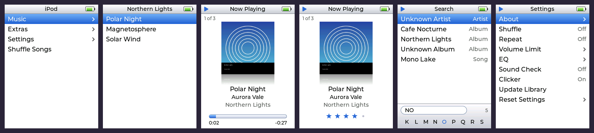
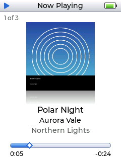
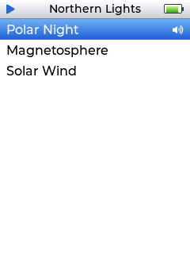
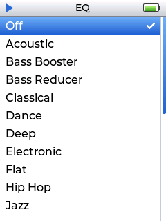
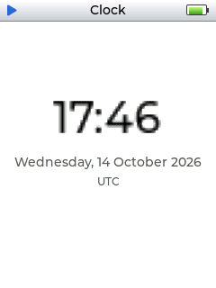
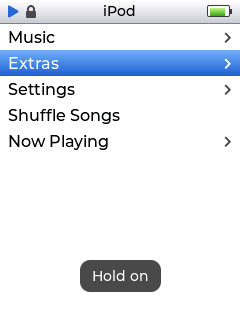
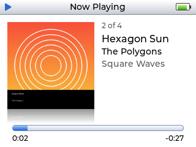

# High Boy FLAC iPod

**High Boy FLAC iPod** is a FLAC music player for the **High Code High Boy** that looks and works like an
**iPod classic (colour)**. It plays FLAC files from the microSD card, lets you
browse by artist, album, song, genre, composer and playlist, and has the
iPod's controls: Now Playing with cover art, scrubbing, ratings, shuffle,
repeat, On-The-Go, Search, EQ, Sound Check, the Clicker and the Hold switch.

It is a native app for **TentacleOS**, the High Boy's firmware (ESP32-P4 +
ESP-IDF + LVGL). It ships with a **desktop simulator** of the High Boy that runs
the same source files, plus unit tests and end-to-end UI tests.



<p>






</p>

## Features

| | |
|---|---|
| **Music** | Playlists · Artists → Albums → Songs · Albums · Compilations · Songs · Genres → Artists · Composers · Search |
| **Playlists** | `.m3u`/`.m3u8` files on the card, On-The-Go, My Top Rated, Recently Added, Recently Played, Top 25 Most Played |
| **Now Playing** | Cover art with the classic reflection, "3 of 12", title/artist/album marquee, progress bar with elapsed/remaining time. The centre button cycles the wheel through **volume → scrubber → rating → shuffle** |
| **Settings** | About, Shuffle (Off/Songs/Albums), Repeat (Off/One/All), Volume Limit, 22 EQ presets, Sound Check (ReplayGain), Clicker, Update Library, Reset Settings |
| **Extras** | Clock, Stopwatch with laps |
| **iPod details** | Sliding menus, blue gradient highlight, scrolling long titles, fast-scroll index letter, scrollbar, battery and play/pause/lock icons in the title bar, gapless playback, "Previous" restarts a song after 3 s, unplayable files are skipped, play counts and ratings are kept |
| **FLAC** | 16/24-bit, 44.1–192 kHz, mono/stereo, embedded art (JPEG incl. progressive, PNG) or `cover.jpg`/`folder.jpg`, Vorbis comments, ID3-prefixed files |

## Controls

The High Boy has a d-pad, OK and BACK. They map onto the click wheel like this:

| High Boy | iPod | What it does |
|---|---|---|
| **UP / DOWN** | scroll wheel | move through lists (hold to scroll faster). In Now Playing: volume up/down, or scrub / rate / change shuffle after pressing OK |
| **OK** | centre button | select. In Now Playing: cycle volume → scrubber → rating → shuffle |
| **OK** (hold) | hold centre | add the highlighted song, album, artist or playlist to On-The-Go |
| **BACK** | MENU | back one level; from the main menu, leave the app |
| **BACK** (hold) | ▶❚❚ | play / pause |
| **LEFT / RIGHT** | ◀◀ / ▶▶ | previous / next song; hold to rewind / fast-forward |
| **OK + BACK** (hold together) | Hold switch | lock / unlock all controls |

In **Search**, LEFT/RIGHT pick letters from the strip, OK adds a letter (`⌫`
deletes), DOWN jumps to the results, UP from the top result returns to the
letters, and BACK leaves Search.

## Putting music on the card

Copy FLAC files anywhere under **`/Music`** on the microSD card, using any
folder layout (if there is no `Music` folder, the whole card is scanned,
skipping TentacleOS's own folders). Tags are read from the files:
`TITLE`, `ARTIST`, `ALBUM`, `ALBUMARTIST`, `GENRE`, `COMPOSER`, `TRACKNUMBER`,
`DISCNUMBER`, `DATE`, `COMPILATION`, `REPLAYGAIN_TRACK_GAIN`. Untagged files show
their file name. Playlists are `.m3u`/`.m3u8` files with relative or absolute
paths.

The first launch shows *Updating Library* while the card is scanned. After
that, the library loads instantly from a cache and refreshes in the background:
new or changed files appear the next time you are at the main menu with nothing
playing, or right away with **Settings → Update Library**. The app keeps its
data in `/.ipod/` on the card (library cache, settings, On-The-Go).

## Installing on the High Boy

```bash
git clone https://github.com/HighCodeh/TentacleOS.git
python3 integration/install_tentacleos.py TentacleOS
cd TentacleOS && ./tools/build.sh && ./tools/flash.sh
```

The installer copies `app/ipod/` into TentacleOS and makes a 13-line change:
it registers `SCREEN_IPOD`, adds **iPod** to the **APPS** carousel and the build
include paths. See [integration/README.md](integration/README.md).

## The simulator

`hb_sim` is a High Boy on your desktop. It has the same 240×320 display, the
same six buttons with TentacleOS's real timing (press, auto-repeat after
400 ms, long-press at 800 ms), the same screen manager, `/sdcard` mapped to a
folder, and `audio_i2s` played through your sound card. It uses LVGL 9.4.0
configured like the device: RGB565, only Montserrat 12/14/16, and a 1 MB image
cache. Something that works in the simulator should therefore also fit on the
device.

```bash
sudo apt install build-essential cmake ninja-build libsdl2-dev flac python3-numpy python3-pil
cmake -S . -B build -G Ninja && cmake --build build
python3 tools/make_test_library.py sdcard          # demo card: 16 original tracks
./build/sim/hb_sim --sd sdcard                       # add --landscape or --launcher
```

| Key | Button |
|---|---|
| Arrow keys / WASD | d-pad |
| Enter / Space | OK |
| Backspace / Esc | BACK |
| F12 | screenshot (PNG) |
| Ctrl+Q | quit |

You can also click and hold the on-screen buttons with the mouse. Environment
options: `HB_AUDIO=sdl|null|fast`, `HB_AUDIO_CAPTURE=out.wav` (records exactly
what the speaker receives), `HB_BATTERY=0..100`, `HB_CHARGING=1`,
`HB_TIME=<epoch>`, `HB_LOG=error|warn|info|debug`.

The demo library is synthesised by `tools/make_test_library.py` (original
melodies, fictional artists, generated cover art). It deliberately includes
the awkward cases: accented tags, a compilation, mono, 24-bit/96 kHz,
ReplayGain, an untagged file, a corrupt file, an ID3-prefixed FLAC and a
playlist. Add `--bulk 400` for a long list.

## Tests

```bash
cd build && ctest            # 13 suites
```

* **Unit tests** (`tests/unit/test_core.c`, 554 checks): UTF-8 folding and
  sorting, metadata parsing, library queries/search/playlists/cache/rescan,
  queue shuffle and repeat, DSP/EQ, settings. Decoding is checked
  **bit-exact against the reference `flac` decoder** (16-bit, mono, 24-bit/96 kHz,
  ID3-prefixed).
* **Player tests** (`tests/unit/test_player.c`): a whole album played through
  the decoder task gives speaker output identical, sample for sample, to
  `flac -d` downmixed with no gaps between songs. Also covered: hi-res
  decimation, pause, seek, previous/next, fast-forward, repeat, shuffle, play
  counts, skipping broken files and cover art.
* **End-to-end UI tests** (`tests/e2e/*.hbs`, 8 suites): scripted button
  presses against the simulator, with assertions on what is on screen and
  playing. They cover navigation, playback controls, settings persistence,
  On-The-Go and Search, Extras and Hold, leaving and re-entering the app,
  picking up new files, landscape, and fast scrolling through 416 songs.
* All of the above also pass under **AddressSanitizer + UndefinedBehaviorSanitizer**
  (`-DHB_SANITIZE=ON`) and **ThreadSanitizer**.
* **ESP32-P4 build check** (`integration/esp32p4_check/run_check.sh`):
  cross-compiles and links the app with ESP-IDF 5.5.3, LVGL 9.4.0 and the real
  TentacleOS headers, with no warnings under `-Werror`.

Script commands for the simulator are `press`/`hold BTN [ms]`, `down`/`up BTN`,
`wait ms`, `find TEXT`, `select TEXT`, `expect FIELD OP VALUE`,
`wait_until FIELD OP VALUE TIMEOUT`, `shot FILE.png`, `cp SRC => DST`,
`repeat N CMD` and `quit`. See `sim/src/main.c` for the fields.

## Layout

```
app/ipod/                 the app (copied into TentacleOS as ui/screens/ipod/)
  ui_ipod.c               LVGL screen: drawing, input, transitions, refresh
  ipod_menu.c             menu model / navigation (no LVGL)
  ipod_player.c           decoder task: gapless dr_flac -> DSP -> audio_i2s
  ipod_dsp.c              downmix, hi-res decimation, EQ, Sound Check, clicker
  ipod_library.c          SD scan, cache, queries, search, playlists, stats
  ipod_meta.c             FLAC metadata (STREAMINFO, Vorbis comments, PICTURE)
  ipod_queue.c            Now Playing list, shuffle, repeat
  ipod_art.c              cover-art worker (stb_image -> RGB565 + reflection)
  ipod_settings.c, ipod_text.c, port/ipod_port_tentacleos.c
  third_party/            dr_flac 0.13.4, stb_image 2.30 (public domain)
sim/                      High Boy simulator (SDL2 + LVGL 9.4) and API shims
tests/                    unit, player and end-to-end tests
tools/make_test_library.py  synthesised FLAC test cards
integration/              TentacleOS installer and ESP32-P4 build check
```

## Notes and limitations

* **Mono speaker.** The High Boy's audio path is a mono class-D amplifier
  (`audio_i2s` streams 16-bit mono), so stereo is downmixed. Hi-res files are
  decimated to 44.1/48 kHz, and 24-bit samples keep their top 16 bits.
* **Text.** The device fonts only contain ASCII, so accented Latin letters are
  shown without accents ("Beyoncé" → "Beyonce"). Scripts with no ASCII
  equivalent (e.g. CJK) show `?`. Sorting and search use the same folding.
* **Playback stops when you leave the app.** This follows the TentacleOS
  close-hook pattern used by its own MP3/WAV players, and avoids clashing with
  the system sounds that the audio driver mutes while streaming.
* **Cover art** is decoded in software. Images over about 2.4 MP (1.2 MP for
  progressive JPEGs) are skipped to stay within PSRAM, and a placeholder note
  is shown instead.
* **Clock** shows UTC, which is what TentacleOS keeps. It reads "Time not set"
  until the time has been synced.
* TentacleOS opens at most 5 SD files at once (`VFS_MAX_FILES`). The app uses
  at most 4 at the same moment.
* `dr_flac` is patched (marked "High Boy FLAC iPod patch") so it can seek in FLAC
  files that start with an ID3v2 tag. Without the patch, such files failed to
  open.
* TentacleOS ships its own SDL simulator (`tools/hle`), but at the time of
  writing (commit `48e1052`) it does not compile (69 failing translation units).
  That is why this repo has its own simulator.

## Licence

GPL-3.0-or-later, like TentacleOS. `dr_flac` and `stb_image` are public domain.
iPod is a trademark of Apple Inc. This is an unofficial tribute that uses no
Apple assets.
